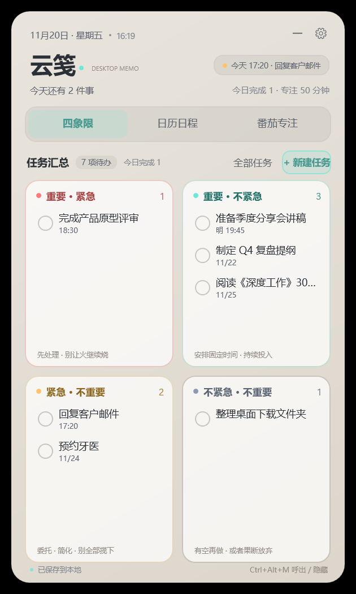
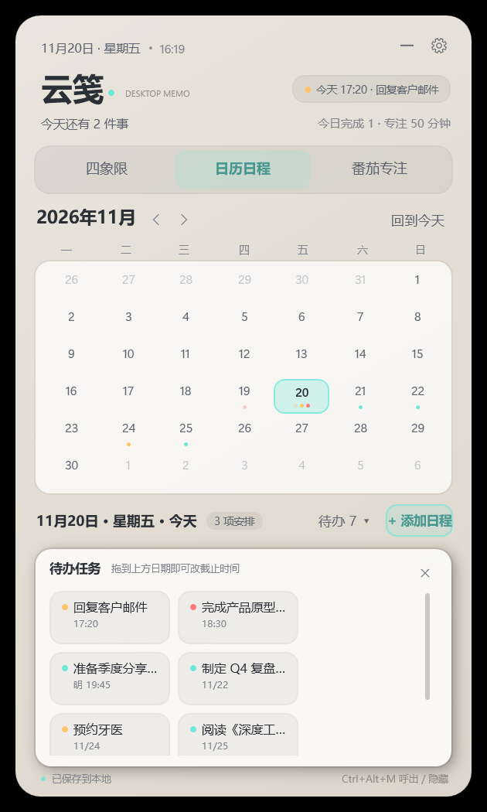
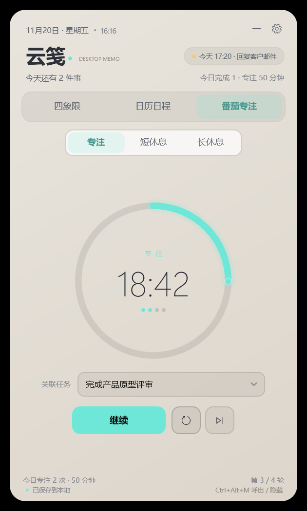
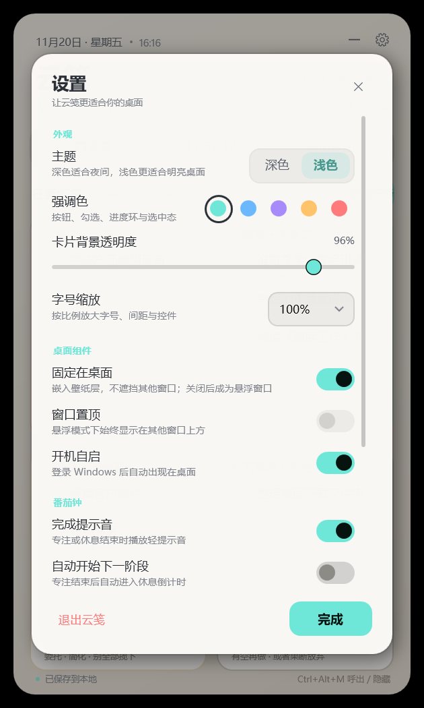

# 云笺 · 桌面备忘录

一个常驻 Windows 桌面的个人备忘录组件：把**四象限任务汇总、日历日程、番茄钟**放在一张桌面卡片里。它不占任务栏，不遮挡正在使用的窗口；按 `Win + D` 回到桌面时就在那里。

> 本地优先：任务与专注记录只保存在本机 JSON 文件中，不上传网络。

> GitHub 仓库：<https://github.com/mashxn/yunjian-memo> · 发布包：<https://github.com/mashxn/yunjian-memo/releases/latest>






> [深色主题预览](docs/dark.png)

## 更新亮点（v1.1）

- **外观自定义**：深色 / 浅色主题，5 种强调色，卡片背景透明度，90%–120% 字号与界面缩放。
- **拖拽整理**：把任务拖到另一个象限即改变重要 / 紧急；在日历页打开「待办」抽屉，把任务拖到某一天即可修改截止日期。
- 拖拽变更支持撤销，截止时间保留原来的时和分；原本没有截止时间的任务默认落在 09:00。

## 快速开始

### 方式一：安装（推荐）

1. 双击 `install.bat`。
2. 脚本会把程序复制到 `%LOCALAPPDATA%\Programs\YunJianMemo`，创建桌面和开始菜单快捷方式，并启动。
3. 首次启动后，可点击卡片右上角齿轮 →「设置」中开启「开机自启」。

### 方式二：便携运行

直接运行：

```text
dist\YunJianMemo\YunJianMemo.exe
```

程序依赖 **.NET 8 Desktop Runtime (x64)**。如果启动时提示缺少运行时，请安装：
<https://dotnet.microsoft.com/download/dotnet/8.0>

> 便携版没有固定安装位置，若移动了文件夹，请重新开启一次「开机自启」，让注册表指向新的 exe。

## 桌面组件说明

- **固定在桌面**：默认将窗口嵌入 Windows 桌面壁纸层，位于普通窗口下方；`Win + D` 显示桌面时仍然可见。
- **可交互**：直接点击任务、日期、按钮即可操作；鼠标左键按住顶部空白区域可拖动卡片，靠近屏幕边缘会轻微吸附。
- **不占任务栏**：程序只显示为右下角托盘图标。
- **呼出 / 隐藏**：`Ctrl + Alt + M`，或双击托盘图标。
- **切换悬浮模式**：右键卡片 →「切换到悬浮模式」，或在设置中关闭「固定在桌面」；悬浮模式下可开启「窗口置顶」。
- **右键卡片**：新建任务、全部任务、切换桌面/悬浮、窗口置顶、隐藏到托盘、退出。

## 功能

### 1. 四象限任务汇总

- 按「重要 / 紧急」自动归入四象限：
  - 重要 · 紧急：先处理
  - 重要 · 不紧急：安排固定时间
  - 紧急 · 不重要：委托或简化
  - 不紧急 · 不重要：有空再做
- 每个象限显示待办数量、标题、截止时间；逾期任务以珊瑚红提示。
- 点击任务可编辑；点击左侧圆圈标记完成，并支持在提示条上撤销。
- **拖动任务到另一个象限**，会自动改变「重要 / 紧急」并归入新象限，支持撤销。
- 「全部任务」中可按未完成 / 已完成 / 全部筛选。

### 2. 日历日程

- 月历视图，任务按截止日期显示为彩色圆点，颜色对应四象限。
- 点击任意日期，下方显示当天的日程安排；可切换月份或回到今天。
- 新建或编辑任务时可设置精确到分钟的截止时间：
  - 支持 `yyyy-MM-dd` 日期和 `HH:mm` 时间；
  - 提供「今天 / 明天 / 后天 / 18:00 / 09:00」快捷设置；
  - 输入 `1830` 也可识别为 `18:30`。
- **待办抽屉**：点击日历右上角「待办 N ▾」，展开待办任务面板；把任务拖到上方任意日期即可修改截止日期。
  - 保留原来的时分；原本没有截止时间的任务默认使用当天 `09:00`。
  - 也可把当天日程列表中的任务拖到其他日期。
- 日历中带截止时间的任务都会显示；没有截止时间的任务可在「全部任务」或待办抽屉中查看。

### 3. 番茄钟

- 专注 / 短休息 / 长休息三种阶段，默认 25 / 5 / 15 分钟，可在设置中修改。
- 可关联一个待办任务；完成的专注次数会累计到该任务。
- 支持开始、暂停、继续、重置、跳过；按空格键也可开始 / 暂停（番茄专注页）。
- 专注完成后自动切换到休息，并可选择「自动开始下一阶段」；带提示音和托盘气泡提醒。
- 今日专注次数、分钟数、当前轮次会实时统计。

### 4. 主题与外观

- **深色 / 浅色主题**：设置中即时切换，无需重启。
- **强调色**：薄荷、天蓝、靛紫、暖橙、珊瑚五种选择，作用于按钮、勾选、进度环和选中态。
- **卡片背景透明度**：65%–100% 可调，文字始终保持清晰。
- **字号缩放**：90% / 100% / 110% / 120%，按比例调整字号、间距与控件。
- 所有外观设置随数据保存在本地，下次启动自动恢复。
## 快捷键

| 快捷键 | 作用 |
| --- | --- |
| `Ctrl + Alt + M` | 呼出 / 隐藏桌面组件 |
| `Ctrl + N` | 新建任务 |
| `Ctrl + 1 / 2 / 3` | 切换四象限 / 日历 / 番茄钟 |
| `Space` | 番茄专注页开始或暂停 |
| `Ctrl + Enter` | 任务编辑框中保存 |
| `Esc` | 关闭当前弹层 |

## 数据与备份

- 数据目录：`%LOCALAPPDATA%\YunJianMemo`
- 主存档：`data.json`
- 自动备份：`data.backup.json`（每次保存前更新）
- 错误日志：`error.log`（仅异常时写入）
- 如果主存档损坏，程序会将其保留为 `data.corrupt-时间戳.json`，并尝试读取备份。
- 设置 →「打开数据文件夹」可直接定位。

删除任务时支持提示条撤销；内部还会在 `DeletedTasks` 中保留最近 50 条记录。个人数据不会随卸载自动删除。

## 卸载

双击 `uninstall.bat`，确认后：

- 安装目录和两个快捷方式会移入**回收站**；
- 清除「开机自启」注册表项；
- 个人数据目录 `%LOCALAPPDATA%\YunJianMemo` **默认保留**，如不需要请自行删除。

## 项目结构

```text
自制备忘录/
├─ dist/YunJianMemo/          已编译的便携版（框架依赖）
├─ src/YunJianMemo/           WPF 源码
│  ├─ MainWindow.xaml(.cs)    窗口、界面、桌面嵌入、托盘
│  ├─ ThemeManager.cs         主题、强调色、透明度与字号缩放
│  ├─ DragDrop.cs             任务拖拽与象限 / 日期投放
│  ├─ Tasks.cs                四象限 / 任务编辑 / 全部任务
│  ├─ Calendar.cs             月历、日程与待办抽屉
│  ├─ Pomodoro.cs             番茄钟
│  ├─ Native.cs               Win32、WorkerW、开机自启
│  ├─ Store.cs                JSON 存储与备份
│  └─ Models.cs               数据模型
├─ docs/                      预览图
├─ tools/                     图标、安装脚本与打包工具
├─ install.bat / uninstall.bat
└─ install.ps1 / uninstall.ps1
```

## 自行构建

需要 .NET 8 SDK 或更高版本（本项目在 .NET 10 SDK 下构建，目标框架为 `net8.0-windows`）。

```powershell
dotnet build src\YunJianMemo\YunJianMemo.csproj -c Release
dotnet publish src\YunJianMemo\YunJianMemo.csproj -c Release -r win-x64 --self-contained false -o dist\YunJianMemo
```

如果希望生成不依赖 .NET 运行时的独立版本：

```powershell
dotnet publish src\YunJianMemo\YunJianMemo.csproj -c Release -r win-x64 --self-contained true -p:PublishSingleFile=true -o dist\YunJianMemo-standalone
```

## 技术说明

- 使用 WPF (.NET 8) 绘制无边框半透明卡片，Windows 10/11 x64。
- 桌面固定：把窗口挂到 Explorer 的桌面图标宿主 `WorkerW` 并置顶，从而既能显示在壁纸上，又能接收鼠标操作。
- 不修改系统文件、不需要管理员权限；开机自启仅写入当前用户 `HKCU\...\Run`。
- 若系统无法提供桌面 `WorkerW`（少数定制系统 / 远程会话），会自动退回悬浮窗口模式。
